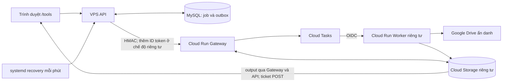

# Hệ thống tạo PDF từ Google Drive

## Mục đích và bản đồ tài liệu

Người dùng mở `/tools/`, dán link Google Drive mở được ẩn danh, nhấn **Tạo PDF**,
theo dõi tiến độ và tải PDF để in. PDF ảnh đáp ứng yêu cầu; không cần OCR.
Source không chứng minh trạng thái production. Mức hoàn thiện chỉ công bố tại
[trạng thái hiện hành](../implementation/status.md).

| Nhu cầu | Tài liệu chuẩn |
| --- | --- |
| Đầu vào, quyền, chất lượng, nghiệm thu | [Yêu cầu sản phẩm](../product-spec/pdf-viewer-links.md) |
| HTTP, database, quota, trạng thái, recovery, ticket | [Đặc tả API/job](pdf-job-api.md) |
| Payload, kết quả, tương thích Worker | [Contract v1](../api/pdf-worker-v1.md), [v2](../api/pdf-worker-v2.md) |
| Kiểm tra, phát hành, giám sát, chi phí, rollback | [Runbook PDF](../operations/cloud-run-pdf-worker.md) |
| Lý do chọn Gateway và hai chế độ xác thực | [ADR định danh producer](../decisions/ADR-pdf-producer-identity.md) |
| Số đo cũ và giới hạn suy luận | [Thử nghiệm chất lượng/tài nguyên](pdf-quality-poc.md) |

## Kiến trúc đã đối chiếu source

1. UI đọc capabilities/lịch sử; submit tạo guest session nếu cần. API chuẩn hóa
   fileId, kiểm idempotency/quota và ghi batch/job/liên kết public cùng transaction.
   HTTP 201 chỉ xác nhận tiếp nhận.
2. Sau commit, API dùng job như outbox: đọc result bền vững trước, rồi mới kiểm
   tra/enqueue task tên xác định. Không gọi Google trong transaction MySQL.
3. Gateway kiểm HMAC, chống replay bằng nonce GCS, chỉ cho phép queue/bucket/URL
   Worker cố định. Cloud Tasks gọi Worker bằng OIDC; Worker không tạo task.
4. Worker ưu tiên tải PDF trực tiếp, kiểm qpdf rồi lưu bytes gốc. Lỗi nguồn phù
   hợp mới sang Viewer ẩn danh ghép PDF ảnh. Không dùng cookies người gửi.
5. V2 tách discovery, phần tối đa 10 trang và merge thành task riêng. GCS giữ
   checkpoint; API/recovery phát bước tiếp. Đóng tab không hủy job đã ghi nhận.
6. API đối chiếu claim/result, cập nhật MySQL. Chỉ COMPLETED chưa hết hạn được
   cấp ticket một lần. PDF stream qua Gateway/API/Nginx, không lưu lâu trên VPS.

## Phiên bản và giới hạn

### Giao diện public `/tools`

Hero căn giữa, tiêu đề và mô tả nằm một dòng từ 1024px; mobile xuống dòng tự
nhiên. Vùng công cụ rộng tối đa 1080px, card tạo PDF và lịch sử luôn xếp dọc,
cách nhau 24px. Nút tạo PDF rộng toàn form trên mobile, căn phải ở màn lớn.
Giữ nền kem, viền hồng pastel và hoa trang trí.

Form dùng toàn chiều rộng card, không có hai khối hỗ trợ “Lưu ý nhỏ” và
“Trạng thái công cụ”. Textarea cao khoảng 144px khi trống trên desktop.
Loading/lỗi kiểm tra/chưa khả dụng chỉ hiện thông báo ngắn; khi enabled không
hiện thông báo trạng thái bổ sung. Lịch sử public vẫn dùng chung giữa thiết bị.
Giới hạn link, trang, nguồn và kết quả chỉ
hiển thị từ capabilities đã tải; không dùng số mặc định khi chưa xác minh.
Trạng thái kiểm tra công cụ, chưa khả dụng và lỗi tải được phân biệt; lịch sử
chỉ hiện empty state sau khi tải thành công và không có tài liệu.

Regression trình duyệt `teacher-tools.e2e.mjs` giữ fixture v1, bổ sung fixture
v2 (1 link, 200 trang, nguồn 20 MiB, kết quả 150 MiB), loading/lỗi API, tên dài,
tiến độ và kiểm tra bố cục tại 360/390/430/768/1023/1024/1280/1440px. Đây là kiểm thử UI với
API giả lập, không chứng minh capabilities production hay xử lý PDF thực tế.

### Giới hạn theo phiên bản

Nguồn chuẩn: `shared/src/pdf-limits.ts`, `server/src/config/pdf-settings.ts` và
guard Worker. `PDF_CHUNKED_JOBS_ENABLED=true` cần đồng bộ các tầng để dùng v2.

| Giới hạn | V1 | V2 |
| --- | --- | --- |
| Trang / PDF kết quả | 40 / 20 MiB | 200 / 150 MiB |
| PDF nguồn tải trực tiếp | 20 MiB | 20 MiB |
| Link/batch; job active; hạn mức giờ mặc định | 5; 10; 10 batch và tối đa 50 job | 1; 3; 20 job gồm manual retry |
| Cách xử lý | Một task | Direct ≤50 trang có thể xong ở discovery; còn lại chia phần |
| Thời gian handler | Mặc định 120 giây, env chỉ hạ | 120 giây mỗi bước |
| Tải qua API | 30 giây | 180 giây |

MiB là 1.048.576 byte. Hạn mức tiếp nhận không bảo đảm thông lượng hoàn thành.
Queue concurrency 1, Worker concurrency 1 và mục tiêu max instances 1 là giới hạn
thực thi riêng. Cấu hình operator thấp hơn vẫn có hiệu lực.

## Renderer và khoảng cách về quyền

Source hiện dùng `view-only`: `selectViewerMode()` chờ Viewer sẵn sàng rồi chụp
bitmap, **không kiểm tra quyền Print/canDownload**. `printFallbackEnabled()`,
`viewerScreenCaptureEnabled()` và long-task gate của Gateway provider luôn trả
true; đặt các env cũ thành false không khôi phục chế độ chỉ tải trực tiếp.
`assemblePrintableViewer()` còn nhánh kiểm Print phục vụ test, không phải đường
renderer production được gọi. Đây là khoảng cách với yêu cầu từ chối nguồn bị
owner/admin cấm tải/in/copy; cần task code/bảo mật riêng, không xem chụp tile vượt
hạn chế là chức năng hợp lệ.

Capture dùng bitmap native, tối đa 12 MP và PNG mã hóa tối đa 32 MiB/lần capture;
đòi ít nhất 200 DPI hiệu dụng khi đặt lên A4 theo chiều trang. Không upscale.
JPEG thử 90 → 85 → 80 từ PNG gốc, 4:4:4, mục tiêu mềm 500.000 byte/trang, không
resize. Chữ nhỏ, trang trắng/ngang và thứ tự phải nghiệm thu trên file thật.
V1 dùng pdf-lib giữ stream ảnh cả tài liệu; v2 ghi JPEG từng trang vào file và
qpdf merge. Không suy RAM từ dung lượng PDF hoặc giới hạn PNG.

Chromium chỉ ở Worker Cloud Run: Node 24.18.0 Debian slim, qpdf/util-linux,
Playwright, sharp, pdf-lib, user node. Gateway dùng Node Alpine và shared dist,
không có renderer. VPS chung 1,5 GB RAM/1 vCPU/15 GB SSD không chạy Chromium;
API container 384 MiB còn phải chia cho HTTP và recovery CLI.
